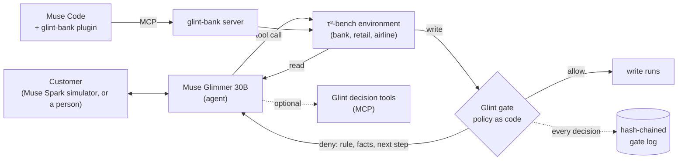
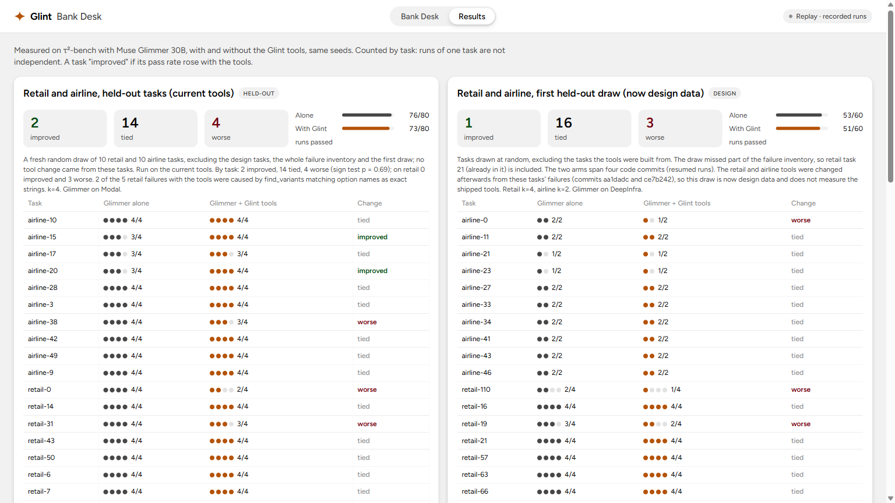

# Glint

[](https://github.com/quanticsoul4772/glint/actions/workflows/tests.yml)

**Verifiable agents: Glint puts Meta's open-weight Muse Glimmer 30B in front of a bank's accounts with the bank's written policy, as code, checking every write before it runs. A write the policy forbids does not run, and every decision goes into a hash-chained log.**

An agent that can move money is only as safe as its worst call. A 30B model holds a customer conversation well and still gets policy decisions wrong: the largest credit-limit increase a card allows, which disputes need a provisional credit, whether a card can be closed. Glint takes those decisions away from the model. Each write the agent attempts goes through a gate that applies the bank's written policy to the live account records. An allowed write runs. A denied write does not run, and the agent gets the rule, what the check found, the facts it used and the next step. The agent cannot skip the check. A gate checks only what its rules encode: a write no rule covers is allowed and logged as such.

**Demo video (2:35, captions):** [youtu.be/tdQuhfSO_9w](https://youtu.be/tdQuhfSO_9w). Every clip is replayed from recorded logs: the Muse Code run of 2026-10-31 and the desk's recorded runs.

## Try it
- **Bank Desk, recorded runs:** [quanticsoul4772.github.io/glint](https://quanticsoul4772.github.io/glint/). The same banking customer, handled by Glimmer alone and by Glimmer with Glint, side by side; the gated pairs show each write a policy gate blocked and what the agent did next. No sign-in.
- **In Muse Code:** the [glint-bank plugin](plugins/glint-bank/README.md) serves a τ² bank over MCP with every write gated. Checked with Muse Code 1.4.14 in headless mode (`muse exec`, 2026-10-31): the server reached `ready` with 23 tools and a $4,000 increase past the tier maximum was refused, then $2,500 allowed. In one interactive session (2026-11-01) Muse shut the plugin's server down at startup, after fetching a fresh feature configuration, so the agent had no bank tools; `scripts/muse_check.py` reads Muse's startup log and says whether the server reached `ready`.
- **Locally:** the desk in replay mode needs no GPU and no keys (see [Run it](#run-it)).


## What the gates are shown to do
Each number says where it comes from.

| Check | Result | Where it comes from |
|---|---|---|
| τ²'s correct actions replayed through the gates (`scripts/gate_replay.py`, `scripts/bank_replay.py`) | **0 false refusals in 289 expected writes** on the 77 banking training tasks | Replays of the benchmark's own correct answers, not live runs. The gates were checked against these during development. |
| Recorded failed runs replayed (`scripts/bank_replay.py`) | **24 of 32 stopped at a gated step**, the database unchanged: 2 by the task's own rule, 22 by a procedure or plan rule (a skipped lookup, an unverified customer, a dispute out of plan order) | The recorded failures the rules were written from (`data-public/wrong-write-runs.json`), so this shows the gates work as designed, not that they catch new mistakes. τ²'s gold accepts 9 of the 24 stopped writes in another order. |
| Live gated runs on 59 tasks no gate change came from (`python -m glint.inspect refusals`; gates at PR 151) | **21 refusals, 0 false**: 6 held a write τ² expects until a required step was done; the other 15 refused writes τ² does not expect (8 card closures with no reason on record), not judged | These tasks' correct answers were in the development replays above, but none of their runs shaped a gate. The same runs show **no pass-rate gain** (below). |
| Muse Code, 2026-10-31 (plugin 0.2.1, Muse Spark as the agent, task_054) | A $4,000 credit-limit increase **denied**; the agent followed the fix and submitted $2,500, **allowed**; the gate log's hash chain verified | One run on a tuned task. The prompt asked for $4,000, so the deny shows the gate and the agent's recovery, not a mistake the agent made on its own. |

The deny the agent got in that Muse Code run, word for word (the verdict JSON shortened):

```
Error: this write was blocked by a policy gate and was NOT executed. Nothing changed.
Rule: banking.cli.submit.reduce_amount (glint.assist.banking.check_credit_limit_increase)
What the check found: the requested increase cannot be submitted as given
Facts it used:
- requested increase $4,000.00 exceeds the premium-tier maximum $2,500.00 (50% of the current limit); do not submit it, offer the maximum instead
Why it matters: Nothing was submitted. Tell the customer the largest increase their card allows and ask whether to submit that.
What to do next: Submit an increase no larger than max_increase in the verdict, for an account of this user.
Verdict: {"current_limit": 5000.0, "max_increase": 2500.0, ...}
```

Built for the Meta Global AI Developer Hackathon (Indie track, theme **Push the Frontier**: a new capability for an open-weight agent). See [Built during the event](#built-during-the-event).

## How it works



1. A customer asks the agent (Glimmer 30B) for something policy-bound: dispute a charge, raise a credit limit, close a card, exchange an item.
2. The agent calls the environment's tools. Reads run as usual.
3. **Every write is intercepted** (`glint.gates.enforce`) and checked by the gates registered for that tool. A gate is a plain function of the live database and the write's arguments, so the same call against the same records always gets the same decision, including when τ²'s evaluator replays the run.
4. A deny returns, as the tool result, the rule, what the check found, the facts it used, why it matters and the next step. Arguments are never rewritten. A gate that raises, times out or returns nothing usable denies (fail closed).
5. Every decision is written to an append-only, hash-chained SQLite log (`glint.gates.eventlog`). At startup, every write tool in the toolkit must have a gate, or enforcement refuses to start.

## The gates
Rules are per write tool, never per task, and each cites the policy document it comes from (`glint.gates.rules`).

| Domain | What is gated |
|---|---|
| Banking | Credit card disputes (card action, provisional-credit flag, and the order of the customer's disputes from `plan_disputes`), credit-limit increases (the tier maximum and the required checks), replacement cards, debit card freeze, close, order and activation, account credits, card closures and retention offers, transfers to a human (the reason code) |
| Banking, procedure | The customer verified in this conversation; the lookups each procedure requires done before the write; a submitted credit-limit increase decided before a dispute or a transfer |
| Retail | Cancel, modify, return and exchange (`check_order_action`); address changes |
| Airline | Cancellation, flight, cabin, baggage and passenger changes; bookings; certificates |

Writes no rule covers yet are allowed and logged as `no_rule_yet`, with the reason (`rules.NO_RULE_YET`). The replays above run on training tasks only; τ²'s banking test split is not used to change any rule.

## Meta AI tooling
- **Muse Glimmer 30B** (open weights) is the agent, **self-hosted** on Modal with vLLM (bf16, A100-80GB, 131K context, scale to zero) by `glint.glimmer_serve`, which adds a health wait, fail-fast boot-log watching, a GPU cap enforced during the session and a retried stop. Every comparison reported here ran on it, except the first retail and airline draws (DeepInfra's hosted Glimmer).
- **Muse Code** loads the [glint-bank plugin](plugins/glint-bank/README.md): a live τ² bank over MCP with every write gated and Glint's decision tools. Checked 2026-10-31 on plugin 0.2.1: the server reached `ready` with 23 tools; read-only tools ran without approval; the $4,000 deny and $2,500 allow above, with the session and call ids matching Muse Code's hook. `/start <task_id>` loads a scenario.
- **Muse Spark** (Meta Model API) plays the customer in τ²-bench and judges its natural-language checks.
- `glint.atem` re-parses Glimmer's tool calls from its raw token stream: the hosted parser turned string arguments such as zip codes into numbers.

## Decision tools
Before the gates, the same checks were offered as seven optional **MCP tools** the agent could call (`python -m glint.assist.server`, stdio). They are still served, and wired into τ²-bench toolkits (`glint.assist.tau2_tools`) and the Muse Code plugin. Measured: Glimmer called one in 1 of 80 runs on τ²'s banking test split, which is why the checks became enforced gates.

| Tool | Domain | Decides |
|---|---|---|
| `check_order_action` | Retail | Whether an order can be cancelled, returned or exchanged; refund methods; price difference |
| `find_user_items` | Retail | Which of the user's items match what they described |
| `find_variants` | Retail | Which product variant matches the requested options |
| `check_reservation_action` | Airline | Cancellation and change eligibility: 24-hour rule, cabin changes, flown segments, insurance |
| `get_upcoming_trips_cost` | Airline | Totals for the user's upcoming trips |
| `check_credit_limit_increase` | Banking | The increase procedure: tier maximum, the required checks in order, approve or deny with the reason |
| `check_card_dispute` | Banking | Card action, provisional-credit criteria, and ordering against other requests |

<!-- results:start (replaced by the refresh-results step; edit the result notes, not this block) -->
## What was measured
τ²-bench v1.0.1, Glimmer at medium reasoning, both arms with the same seeds on the same backend. Reported **by task** (runs of one task are not independent); tuned and untuned tasks apart, latest first. Full detail: [docs/results.md](docs/results.md).

- **Banking, 59 unseen tasks, every write gated: no gain** (k=2, the gated arm on the code at PR 151, before the search fix of PR 171). On 108 matched runs Glimmer alone passed 21 and gated 19; by task 5 better, 8 worse (sign test p = 0.58, two-sided). These are the training tasks outside the 12 the gates were built on whose correct answers make a gated write; no change came from their runs.
  - Alone's misses include 30 context overflows (gated: 3); on the 39 tasks where alone never overflowed, alone passed 20 and gated 19. The gated arm hit τ²'s step limit in 41 of 108 runs, all failed; 83% of their calls were knowledge-base searches. The likely cause, not tested, is the search's budget, which PR 171 changed after this run.
  - The gate refused 21 writes in these runs: 0 false (above). 20 of the gated arm's failed runs still filed a write with a wrong value (a field the gates do not check).
- **Banking with every write gated (v9, design data): no gain shown on untuned tasks (2 tasks, 2/8 → 4/8); on 10 tuned tasks 6 improved and 1 worse against Glimmer alone, not significant** (the same 12 tasks, k=4; the gated arm also has the decision tools, a dispute plan and open-item reminders; code at PR 147).
  - **10 tuned tasks** (the gates, the plan and the reminders were shaped by their runs): 039: 0/4 → 4/4; 054: 0/4 → 4/4; 040, 041, 051, 052: 0/4 → 3/4; 031, 038, 081 tied; 037 worse (4/4 → 2/4); sign test p = 0.0625 (one-sided); runs 7/40 → 25/40. Do not read as general evidence.
  - **2 untuned tasks:** 050: 2/4 → 4/4; 053 tied at 0/4 (likely the simulated customer's answers; not checked); runs 2/8 → 4/8. Two tasks cannot reach p < 0.05.
  - v9 is the latest of nine reported gated versions (v3 stopped early), each a change made after reading the one before. Tuned totals ranged from 7/40 to 25/40 and v9 is the highest; against v8 (19/40) it is 5 tasks better and 2 worse (p = 0.23, one-sided), so the differences between versions are not established at k=4. Untuned stayed at 4/8 from v4 through v9. All versions by task: [docs/results.md](docs/results.md#banking-write-gates-enforced-design-data-k4).
  - In v9's runs, 0 of the 39 gate refusals that could be judged against τ²'s expected writes were false (55 write refusals; the other 16 refused writes that differ from the expected ones and are not judged).
- **Banking, current tools: the only domain with a gain, not significant** (12 tasks with a dispute or credit-limit step, k=4).
  - **10 untuned tasks: 3 improved** (037: 0/4 → 3/4; 050: 2/4 → 4/4; 052: 0/4 → 1/4), 7 tied, 0 worse; sign test p = 0.25; runs 6/40 → 12/40. Their correct answers were used to check the tools' rules, so they are not fully held-out.
  - **2 tuned tasks improved** (038: 0/4 → 1/4; 054: 0/4 → 4/4). The tools were refined after reading their runs.
  - Wrong writes (writes Glint's own checks judge wrong) did not fall on the untuned tasks: 39 without the tools vs 43 with. On the tuned tasks: 11 → 0.
- **Retail and airline: no gain, and on retail the tools lose runs.** Held-out tasks on the current tools (k=4): retail 39/40 without the tools vs 35/40 with; airline 37/40 vs 38/40. By task: 2 improved, 14 tied, 4 worse (sign test p = 0.69).
- **Banking test split, read once as the final check (20 untouched tasks, k=4, tools without gates): no gain.** 10/80 without the tools vs 10/80 with; by task 1 improved (047: 0/4 → 1/4), 1 worse (036: 4/4 → 3/4), 18 tied. Only task_080 has a dispute or credit-limit step, and a decision tool was called in 1 of the 80 runs, so the split mainly shows the tools neither helped nor hurt tasks they were not built for. There is no gated run on this split: the gate rules were shaped partly by its failures.
- Earlier runs on tool code from before the 7789817 verdict fixes are superseded; they are kept in [docs/results.md](docs/results.md) because the desk's decision-tools pairs come from them.



<!-- results:end -->
## Limitations
- **The gates block the specific steps they encode; they do not make every write correct, and they have not been shown to raise pass rates.** On the 59 unseen tasks the gated arm passed 19 of 108 matched runs against Glimmer alone's 21; 20 of its failed runs still filed a write with a wrong value, and 65 of its 643 live gate decisions were allows for writes no rule covers.
- **Within-harness only.** Muse Spark plays the customer, so the numbers are not comparable with the τ²-bench leaderboard.
- **Small samples.** k=2 to 4 per task; no sign test is significant.
- **The gates' rules were written and checked on training tasks**, so the replay numbers and the gated results on those 12 tasks are in-sample. A deny that lands on a run's first wrong write shows the gate caught that write, not that the run would then pass.
- **The desk's replay pairs are selected:** a failed run without Glint beside a passed run with it. The gated pairs' arm also has the decision tools and the dispute plan, so a pair does not show the gate alone caused the pass; an earlier gated version passed task_054 4/4 without blocking anything. The page says so and shows each task's real pass counts. Live mode runs no gates and is off on the hosted desk.
- **Retail:** `find_variants` matches option names as exact strings (it called the user's "Google Home" unavailable when the catalog says "Google Assistant").
- **Banking:** Glimmer still fails most tasks; task 081 overflows the context.

## Run it
Requires Python 3.12, [uv](https://docs.astral.sh/uv/) and git. τ²-bench is about 1.4 GB.

```bash
git clone -c core.longpaths=true https://github.com/quanticsoul4772/glint
git clone -c core.longpaths=true -c core.autocrlf=false https://github.com/sierra-research/tau2-bench vendor/tau2-bench
git -C vendor/tau2-bench checkout fc0055dc4e0a316c3f83133267fbd6faaa770992   # τ²-bench v1.0.1, pinned; stop if this fails
cd glint
uv sync --extra dev
uv run pytest -q
```

τ²-bench goes next to the repo (`../vendor/tau2-bench`, as `pyproject.toml` expects). On Windows, the `core.longpaths` and `core.autocrlf` settings are required: without them some τ² data files fail to check out, the pin fails, and `uv sync` installs a different τ² version; and the bundled bank data no longer matches τ²'s byte for byte.

- **The gate replays** (no GPU, no keys, no workspace needed): `uv run python scripts/gate_replay.py` and `uv run python scripts/bank_replay.py`.
- **Bank Desk, replay mode** (no GPU, no keys): `uv run python -m glint.desk.app`, then open http://127.0.0.1:8765.
- **glint-bank in Muse Code:** see [plugins/glint-bank/README.md](plugins/glint-bank/README.md). Check an install without Muse or a model: `uv run python -m glint.bank.server --decision-tools --selftest`.
- **Bank Desk, live mode:** needs a deployed Glimmer endpoint (`modal deploy src/glint/glimmer_serve.py`) and the keys in [.env.example](.env.example), copied to `$GLINT_HOME/.env`.
- **Decision-tool MCP server:** `uv run python -m glint.assist.server` (stdio).
- **With/without comparisons:** `scripts/tools_ab.py` (checkpointed; both arms on the same backend; a set's tools arm enforces the gates unless the set says otherwise; `--help` lists the sets). `scripts/export_results.py` and `scripts/export_scenarios.py` regenerate the desk's data from the run data. Every script is listed in [scripts/README.md](scripts/README.md).
- **Workspace:** working files (run data, the spend ledger, results, `.env`) live outside the repo, under `GLINT_HOME`, which defaults to the repo's parent folder. The task splits (`splits/`) and the recorded wrong-write runs (`data-public/`) are in the repo.
- **Tests:** coverage goals and rules in [docs/testing-strategy.md](docs/testing-strategy.md); CI runs pytest with the coverage gate and ruff on every PR.

## Built during the event
- All code in this repo was written during the event (Oct 26 – Nov 4, 2026). The first commit is `952dd30` on 2026-10-26.
- This history was rewritten on Oct 31 to remove the author's name, local paths and session links. Authors and dates are unchanged; the only changes to files are local folder paths in comments, now `<workspace>`, and one coverage data file removed. The old-to-new commit map is in [docs/history-map.txt](docs/history-map.txt). The original repository, with its pull request and CI record, is private, and the organizers can be given access. PR numbers in this repo ("PR 147") refer to that record.
- The gate runner and event log reuse design patterns from the author's earlier work; all code here was written during the event.
- Third-party work, used under its license: [τ²-bench](https://github.com/sierra-research/tau2-bench) (MIT, Sierra Research) is the benchmark and a dependency; its banking data is bundled in `plugins/glint-bank/data/` with its license. The desk's spacing, type and color scales follow Astryx's neutral theme (MIT, Meta Platforms).

## License
[MIT](LICENSE).
