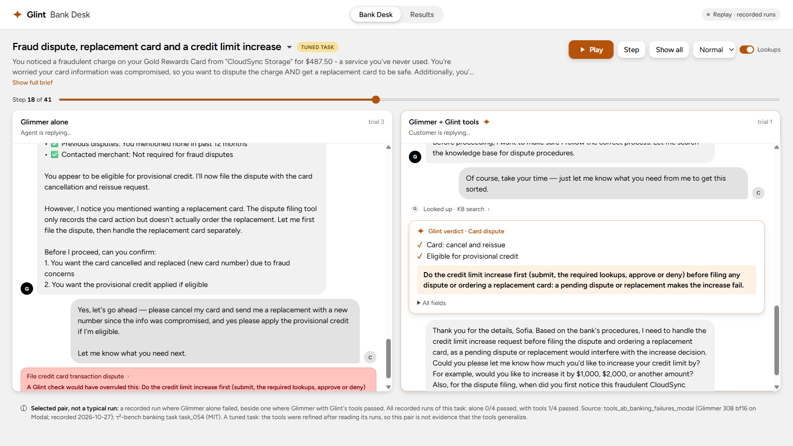

# Glint

**Deterministic decision tools that take over the analytical decisions of Meta's open-weight Muse Glimmer 30B.**

A 30B model can hold a customer conversation, but it often gets the decision wrong. Examples: whether a policy allows a cancellation, which variant matches what the customer described, whether a credit-limit increase must come before a dispute. Glint moves those decisions out of the model into small, deterministic tools (policy as code). The model calls a tool, gets an authoritative verdict with its reasons, and acts on it.

**Try it:** [Glint Bank Desk](https://quanticsoul4772--glint-desk-web.us-east.modal.run): the same banking customer, handled by Glimmer alone and by Glimmer with the Glint tools, side by side (recorded runs; no sign-in).



Built for the Meta Global AI Developer Hackathon (Indie track, theme **Push the Frontier**: a new capability for an open-weight agent). All code in this repo was written during the event: the first commit is 2026-10-26 (`952dd30`), and the full history is public.

## How it works
1. A customer asks the agent (Glimmer 30B) for something policy-bound: dispute a charge, raise a credit limit, exchange an item.
2. Before acting, Glimmer calls a Glint tool with the facts it has.
3. The tool reads the account records and applies the written policy in code. No model inside.
4. It returns a verdict: what is allowed, what to do, in what order, and why.
5. Glimmer acts on the verdict and keeps the conversation.

**Example** (recorded, τ²-bench banking task 054). Glimmer calls `check_card_dispute` for a fraudulent $487.50 charge, with a replacement card and a credit-limit increase also requested:

```json
{
  "card_action": "cancel_and_reissue",
  "eligible_for_provisional_credit": "True",
  "provisional_credit_criteria": {"account_open_60_days": "True", "reason_qualifies": "True", "amount_in_range": "True",
                                  "at_most_2_disputes_past_12_months": "True", "merchant_contacted_if_not_fraud": "True"},
  "sequencing": "Do the credit limit increase first (submit, the required lookups, approve or deny) before filing any dispute or ordering a replacement card: a pending dispute or replacement makes the increase fail."
}
```
In the recorded pair, Glimmer alone filed the dispute first (a write a Glint check would overrule) and failed the task; with the verdict it did the increase first and passed.

## The tools
Seven tools, served as an **MCP server** (`python -m glint.assist.server`, stdio) usable from any MCP client, and wired into τ²-bench toolkits for measurement (`glint.assist.tau2_tools`).

| Tool | Domain | Decides |
|---|---|---|
| `check_order_action` | Retail | Whether an order can be cancelled, returned or exchanged; refund methods; price difference |
| `find_user_items` | Retail | Which of the user's items match what they described |
| `find_variants` | Retail | Which product variant matches the requested options |
| `check_reservation_action` | Airline | Cancellation and change eligibility: 24-hour rule, cabin changes, flown segments, insurance |
| `get_upcoming_trips_cost` | Airline | Totals for the user's upcoming trips |
| `check_credit_limit_increase` | Banking | The increase procedure: tier maximum, the required checks in order, approve or deny with the reason |
| `check_card_dispute` | Banking | Card action, provisional-credit criteria, and ordering against other requests |

## Meta AI tooling
- **Muse Glimmer 30B** (open weights) is the agent, **self-hosted** on Modal with vLLM (bf16, A100-80GB, 131K context, scale to zero) by `glint.glimmer_serve`, which adds a health wait, fail-fast boot-log watching, a GPU cap enforced during the session and a retried stop.
- **Muse Spark** (Meta Model API) plays the customer in τ²-bench and judges its natural-language checks.
- **Spark Open** (open weights, on Baseten) takes over as the customer in the desk's live mode if Meta's API cannot serve it.
- **Muse Code** loads Glint's MCP server as a client: in a check on 2026-10-28, Muse Code 1.4.14 loaded the 7 tools and Spark called `check_credit_limit_increase` end to end.
- `glint.atem` re-parses Glimmer's tool calls from its raw token stream: the hosted parser turned string arguments such as zip codes into numbers.

## What was measured
τ²-bench v1.0.1, Glimmer at medium reasoning, both arms with the same seeds on the same backend. Reported **by task** (runs of one task are not independent); tuned and untuned tasks apart. Full detail: [docs/results.md](docs/results.md).

- **Banking, current tools: the only domain with a gain, not significant** (12 tasks with a dispute or credit-limit step, k=4).
  - **10 untuned tasks: 3 improved** (037: 0/4 → 3/4; 050: 2/4 → 4/4; 052: 0/4 → 1/4), 7 tied, 0 worse; sign test p = 0.25; runs 6/40 → 12/40. Their correct answers were used to check the tools' rules, so they are not fully held-out.
  - **2 tuned tasks improved** (038: 0/4 → 1/4; 054: 0/4 → 4/4). The tools were refined after reading their runs.
  - Wrong writes (writes Glint's own checks judge wrong) did not fall on the untuned tasks: 39 without the tools vs 43 with. On the tuned tasks: 11 → 0.
- **Retail and airline: no gain, and on retail the tools lose runs.** Held-out tasks on the current tools (k=4): retail 39/40 without the tools vs 35/40 with; airline 37/40 vs 38/40. By task: 2 improved, 14 tied, 4 worse (sign test p = 0.69).
- **In progress:** τ²'s untouched banking test split (all 20 tasks, k=4); only task_080 has a dispute or credit-limit step. Results will be added when it ends.
- Earlier runs on tool code from before the ce7b242 verdict fixes are superseded; they are kept in [docs/results.md](docs/results.md) because the desk's replay pairs come from them.


## Limitations
- **Within-harness only.** Muse Spark plays the customer, so the numbers are not comparable with the τ²-bench leaderboard.
- **Small samples.** k=4 per task; no sign test is significant.
- **Retail:** the tools cost runs. `find_variants` matches option names as exact strings (it called the user's "Google Home" unavailable when the catalog says "Google Assistant"); the tools are frozen, so the defect is reported, not fixed.
- **Banking:** Glimmer still fails most tasks with the tools; task 081 overflows the context; wrong writes did not fall on untuned tasks.
- **The desk's replay pairs are selected wins** (a failed run without the tools beside a passed run with them), from runs on earlier tool code; the page says so and shows each task's real pass counts. Live mode is off on the public desk because each pair runs a GPU.

## Run it
Requires Python 3.12 and [uv](https://docs.astral.sh/uv/).

```bash
git clone https://github.com/sierra-research/tau2-bench ../vendor/tau2-bench
git -C ../vendor/tau2-bench checkout fc0055dc4e0a316c3f83133267fbd6faaa770992   # tau2-bench v1.0.1, pinned
uv sync --extra dev
uv run pytest -q
```

- **Bank Desk, replay mode** (no GPU, no keys): `uv run python -m glint.desk.app`, then open http://127.0.0.1:8765.
- **Bank Desk, live mode:** needs a deployed Glimmer endpoint (`modal deploy src/glint/glimmer_serve.py`) and `GLINT_GLIMMER_URL`, `MODAL_PROXY_KEY`, `MODAL_PROXY_SECRET` and `MODEL_API_KEY` set; `BASETEN_API_KEY` enables the Spark Open customer fallback.
- **MCP server:** `uv run python -m glint.assist.server` (stdio).
- **With/without comparisons:** `scripts/tools_ab.py` (checkpointed; both arms on the same backend); `scripts/export_results.py` and `scripts/export_scenarios.py` regenerate the desk's data from the runs.
- **Workspace:** working files (run data, ledger, results, `.env`) live outside the repo, under `GLINT_HOME`, which defaults to the repo's parent folder.
- **Tests:** coverage goals and rules in [docs/testing-strategy.md](docs/testing-strategy.md); CI runs them on every PR.

## License
MIT. τ²-bench (MIT, Sierra Research) is a dependency, and its banking tasks appear in the Bank Desk replay data. The desk's spacing, type and color scales follow Astryx's neutral theme (MIT, Meta Platforms).
