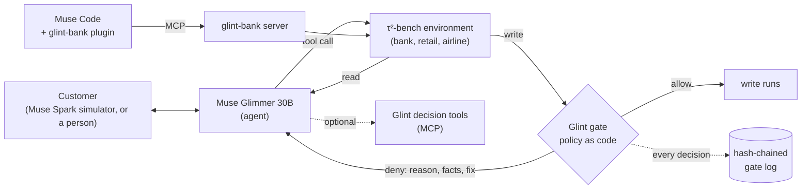

# Glint

[](https://github.com/quanticsoul4772/glint/actions/workflows/tests.yml)

**Deterministic policy gates for Meta's open-weight Muse Glimmer 30B: every write the agent makes is checked against the written policy before it runs.**

A 30B model can hold a customer conversation, but it often gets the decision wrong. Examples: whether a policy allows a cancellation, which variant matches what the customer described, whether a credit-limit increase must come before a dispute. Glint moves those decisions out of the model into code. Each write the agent attempts goes through a gate that applies the policy to the live account records. An allowed write runs. A denied write does not run, and the agent gets the reason, the facts the gate used and the next step. The agent cannot skip the check.

**Try it:** [Glint Bank Desk](https://quanticsoul4772--glint-desk-web.us-east.modal.run): the same banking customer, handled by Glimmer alone and by Glimmer with Glint, side by side (recorded runs; no sign-in).


Built for the Meta Global AI Developer Hackathon (Indie track, theme **Push the Frontier**: a new capability for an open-weight agent). See [Built during the event](#built-during-the-event).

## How it works



1. A customer asks the agent (Glimmer 30B) for something policy-bound: dispute a charge, raise a credit limit, close a card, exchange an item.
2. The agent calls the environment's tools. Reads run as usual.
3. **Every write is intercepted** (`glint.gates.enforce`) and checked by the gates registered for that tool. A gate is a plain function of the live database and the write's arguments, so the same call against the same records always gets the same decision, including when τ²'s evaluator replays the run.
4. A deny returns, as the tool result, the rule, what the check found, the facts it used, why it matters and the next step. Arguments are never rewritten. A gate that raises, times out or returns nothing usable denies (fail closed).
5. Every decision is written to an append-only, hash-chained SQLite log (`glint.gates.eventlog`). At startup, every write tool in the toolkit must have a gate, or enforcement refuses to start.

## The gates
Rules are per write tool, never per task, and each cites the policy document it comes from (`glint.gates.rules`).

| Domain | What is gated |
|---|---|
| Banking | Credit card disputes (card action, provisional-credit flag, and the order of the customer's disputes from `plan_disputes`), credit-limit increases (the tier maximum and the required checks), replacement cards, debit card freeze, close, order and activation, account credits, card closures and retention offers, transfers to a human (the reason code) |
| Banking, procedure | The customer verified in this conversation; the lookups each procedure requires done before the write; a submitted credit-limit increase decided before a dispute or a transfer |
| Retail | Cancel, modify, return and exchange (`check_order_action`); address changes |
| Airline | Cancellation, flight, cabin, baggage and passenger changes; bookings; certificates |

Writes no rule covers yet are allowed and logged as `no_rule_yet`, with the reason (`rules.NO_RULE_YET`).

**Validation** (scripts in `scripts/`, each also a test):
- `gate_replay.py`: τ²'s correct (gold) actions for every training task of the three domains go through the gates; a gold write that is denied is a false refusal.
- `gate_catch.py`: recorded failed runs are replayed through the gates, to see whether the first wrong write would have been stopped.
- Both are run on training tasks only; τ²'s banking test split is not used to change any rule.

## Decision tools
Before the gates, the same checks were offered as seven optional **MCP tools** the agent could call (`python -m glint.assist.server`, stdio). They are still served, and wired into τ²-bench toolkits (`glint.assist.tau2_tools`). Measured: Glimmer called them in only 2 of 80 runs on τ²'s banking test split, which is why the checks became enforced gates.

| Tool | Domain | Decides |
|---|---|---|
| `check_order_action` | Retail | Whether an order can be cancelled, returned or exchanged; refund methods; price difference |
| `find_user_items` | Retail | Which of the user's items match what they described |
| `find_variants` | Retail | Which product variant matches the requested options |
| `check_reservation_action` | Airline | Cancellation and change eligibility: 24-hour rule, cabin changes, flown segments, insurance |
| `get_upcoming_trips_cost` | Airline | Totals for the user's upcoming trips |
| `check_credit_limit_increase` | Banking | The increase procedure: tier maximum, the required checks in order, approve or deny with the reason |
| `check_card_dispute` | Banking | Card action, provisional-credit criteria, and ordering against other requests |

## Meta AI tooling
- **Muse Glimmer 30B** (open weights) is the agent, **self-hosted** on Modal with vLLM (bf16, A100-80GB, 131K context, scale to zero) by `glint.glimmer_serve`, which adds a health wait, fail-fast boot-log watching, a GPU cap enforced during the session and a retried stop.
- **Muse Spark** (Meta Model API) plays the customer in τ²-bench and judges its natural-language checks.
- **Spark Open** (open weights, on Baseten) takes over as the customer in the desk's live mode if Meta's API cannot serve it.
- **Muse Code** loads the [glint-bank plugin](plugins/glint-bank/README.md): a live τ² bank served over MCP (`python -m glint.bank.server`), with every write gated; `/start <task_id>` loads a scenario. In the checks of 2026-10-28 the plugin's server reached `ready` in Muse Code. Muse Code 1.4.14 also loaded Glint's decision-tool MCP server (7 tools), and Spark called `check_credit_limit_increase` end to end.
- `glint.atem` re-parses Glimmer's tool calls from its raw token stream: the hosted parser turned string arguments such as zip codes into numbers.

<!-- results:start (replaced by the refresh-results step; edit the result notes, not this block) -->
## What was measured
τ²-bench v1.0.1, Glimmer at medium reasoning, both arms with the same seeds on the same backend. Reported **by task** (runs of one task are not independent); tuned and untuned tasks apart. Full detail: [docs/results.md](docs/results.md).

- **Banking with every write gated (v9, design data): no gain shown on untuned tasks (2 tasks, 2/8 → 4/8); on 10 tuned tasks 6 improved and 1 worse against Glimmer alone, not significant** (the same 12 tasks, k=4; the gated arm also has the decision tools, a dispute plan and open-item reminders; code at #147).
  - **10 tuned tasks** (the gates, the plan and the reminders were shaped by their runs): 039: 0/4 → 4/4; 054: 0/4 → 4/4; 040, 041, 051, 052: 0/4 → 3/4; 031, 038, 081 tied; 037 worse (4/4 → 2/4); sign test p = 0.0625 (one-sided); runs 7/40 → 25/40. Do not read as general evidence.
  - **2 untuned tasks:** 050: 2/4 → 4/4; 053 tied at 0/4 (likely the simulated customer's answers; not checked); runs 2/8 → 4/8. Two tasks cannot reach p < 0.05.
  - v9 is the latest of nine reported gated versions (v3 stopped early), each a change made after reading the one before. Tuned totals ranged from 7/40 to 25/40 and v9 is the highest; against v8 (19/40) it is 5 tasks better and 2 worse (p = 0.23, one-sided), so the differences between versions are not established at k=4. Untuned stayed at 4/8 from v4 through v9. All versions by task: [docs/results.md](docs/results.md#banking-write-gates-enforced-design-data-k4).
  - v9 ran on the code at #147. #148 and #149 changed refusal wording and which requests count as a credit limit increase afterwards; none of their cases occurred in v9's runs.
  - In v9's runs, 0 of the 39 gate refusals that could be judged against τ²'s expected writes were false (55 write refusals; the other 16 refused writes that differ from the expected ones and are not judged).
  - Replaying τ²'s expected actions for the 77 banking training tasks through the gates (current code, after #149): 0 false refusals in 289 expected writes, with the plan and ask-once steps an agent following the gates adds (task_005's 2 writes on placeholder verification are denied and listed apart).
- **Banking, current tools: the only domain with a gain, not significant** (12 tasks with a dispute or credit-limit step, k=4).
  - **10 untuned tasks: 3 improved** (037: 0/4 → 3/4; 050: 2/4 → 4/4; 052: 0/4 → 1/4), 7 tied, 0 worse; sign test p = 0.25; runs 6/40 → 12/40. Their correct answers were used to check the tools' rules, so they are not fully held-out.
  - **2 tuned tasks improved** (038: 0/4 → 1/4; 054: 0/4 → 4/4). The tools were refined after reading their runs.
  - Wrong writes (writes Glint's own checks judge wrong) did not fall on the untuned tasks: 39 without the tools vs 43 with. On the tuned tasks: 11 → 0.
- **Retail and airline: no gain, and on retail the tools lose runs.** Held-out tasks on the current tools (k=4): retail 39/40 without the tools vs 35/40 with; airline 37/40 vs 38/40. By task: 2 improved, 14 tied, 4 worse (sign test p = 0.69).
- **Banking test split, read once as the final check (20 untouched tasks, k=4, tools without gates): no gain.** 10/80 without the tools vs 10/80 with; by task 1 improved (047: 0/4 → 1/4), 1 worse (036: 4/4 → 3/4), 18 tied. Only task_080 has a dispute or credit-limit step, and a decision tool was called in 1 of the 80 runs, so the split mainly shows the tools neither helped nor hurt tasks they were not built for. There is no gated run on this split: the gate rules were shaped partly by its failures.
- Earlier runs on tool code from before the ce7b242 verdict fixes are superseded; they are kept in [docs/results.md](docs/results.md) because the desk's replay pairs come from them.


<!-- results:end -->
## Limitations
- **Within-harness only.** Muse Spark plays the customer, so the numbers are not comparable with the τ²-bench leaderboard.
- **Small samples.** k=4 per task; no sign test is significant.
- **The gates' rules were written and checked on training tasks**, so gated results on those tasks are in-sample. A deny that lands on a run's first wrong write shows the gate caught that write, not that the run would then pass.
- **Retail:** `find_variants` matches option names as exact strings (it called the user's "Google Home" unavailable when the catalog says "Google Assistant").
- **Banking:** Glimmer still fails most tasks; task 081 overflows the context.
- **The desk's replay pairs are selected wins** (a failed run without Glint beside a passed run with it), from runs on earlier tool code; the page says so and shows each task's real pass counts. Live mode is off on the public desk because each pair runs a GPU.

## Run it
Requires Python 3.12, [uv](https://docs.astral.sh/uv/) and git. τ²-bench is about 1.4 GB.

```bash
git clone -c core.longpaths=true https://github.com/quanticsoul4772/glint
git clone -c core.longpaths=true -c core.autocrlf=false https://github.com/sierra-research/tau2-bench vendor/tau2-bench
git -C vendor/tau2-bench checkout fc0055dc4e0a316c3f83133267fbd6faaa770992   # τ²-bench v1.0.1, pinned; stop if this fails
cd glint
uv sync --extra dev
uv run pytest -q
```

τ²-bench goes next to the repo (`../vendor/tau2-bench`, as `pyproject.toml` expects). On Windows, the `core.longpaths` and `core.autocrlf` settings are required: without them some τ² data files fail to check out, the pin fails, and `uv sync` installs a different τ² version; and the bundled bank data no longer matches τ²'s byte for byte.

- **Bank Desk, replay mode** (no GPU, no keys): `uv run python -m glint.desk.app`, then open http://127.0.0.1:8765.
- **Bank Desk, live mode:** needs a deployed Glimmer endpoint (`modal deploy src/glint/glimmer_serve.py`) and the keys in [.env.example](.env.example), copied to `$GLINT_HOME/.env`.
- **glint-bank in Muse Code:** see [plugins/glint-bank/README.md](plugins/glint-bank/README.md). Check an install without Muse or a model: `uv run python -m glint.bank.server --selftest`.
- **Decision-tool MCP server:** `uv run python -m glint.assist.server` (stdio).
- **With/without comparisons:** `scripts/tools_ab.py` (checkpointed; both arms on the same backend; a set's tools arm enforces the gates unless the set says otherwise). `scripts/export_results.py` and `scripts/export_scenarios.py` regenerate the desk's data. Every script is listed in [scripts/README.md](scripts/README.md).
- **Workspace:** working files (run data, the spend ledger, results, `.env`) live outside the repo, under `GLINT_HOME`, which defaults to the repo's parent folder.
- **Tests:** coverage goals and rules in [docs/testing-strategy.md](docs/testing-strategy.md); CI runs pytest with the coverage gate and ruff on every PR.

## Built during the event
- All code in this repo was written during the event (Oct 26 – Nov 4, 2026). The first commit is `952dd30` on 2026-10-26, and the full history is public.
- The gate runner and the event log follow the design of two earlier projects by the same author (private); no code was copied from them.
- Third-party work, used under its license: [τ²-bench](https://github.com/sierra-research/tau2-bench) (MIT, Sierra Research) is the benchmark and a dependency; its banking data is bundled in `plugins/glint-bank/data/` with its license. The desk's spacing, type and color scales follow Astryx's neutral theme (MIT, Meta Platforms).

## License
[MIT](LICENSE).
