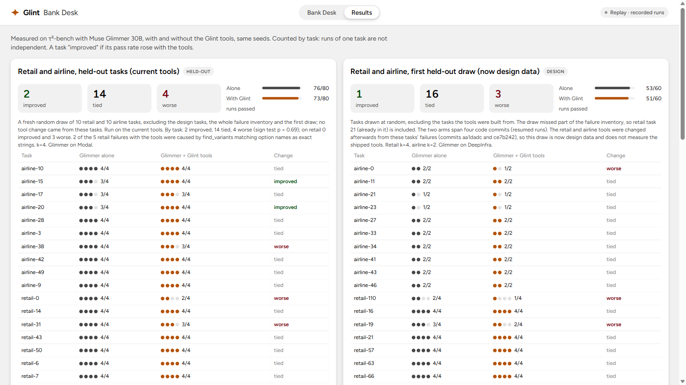

# What the gates are shown to do, and what was measured

Moved here from the README on 2026-11-03, unchanged except for link paths. Full per-run detail is in [results.md](results.md).

## What the gates are shown to do


Glint makes two claims with different evidence. **Enforcement integrity**, that every write is checked before it runs, a denied write never runs, every refusal carries the rule, the facts and the next step, and every decision is logged tamper-evidently, is shown below on Glimmer's runs and holds by construction for any model behind the gate. **Fewer wrong writes** depends on which policy clauses the rules encode and on the agent acting on a refusal, and on unseen tasks it is not yet shown (see [What was measured](evidence.md#what-was-measured)). Each number says where it comes from.

| Check | Result | Where it comes from |
|---|---|---|
| τ²'s correct actions replayed through the gates (`scripts/gate_replay.py`, `scripts/bank_replay.py`) | **289 expected writes on the 77 banking training tasks: 0 refusals the policy text would call false; 2 refusals against τ²'s gold**, both task_005's, whose expected actions change the email of a user verified with placeholder data (the same case counted as the one false live refusal below). **Since PR #44 (every fix on by default), one more: task_091's debit card order, refused by the entry-tier 48-hour wait** (doc 029 says wait; doc 031 conflicts), listed by the replay scripts as KNOWN (decided), not counted, so both exit 0; 3 refusals in all (task_005 ×2, task_091), 286 of the 289 allowed | Replays of the benchmark's own correct answers, not live runs. In-sample: the gates were checked against these during development, so as a bound on writes like these it says at most 1.0% per write and 3.8% per task (one-sided 95%), and nothing about live writes. |
| Recorded failed runs replayed (`scripts/bank_replay.py`) | **24 of 32 stopped at a gated step**, the database unchanged: 2 by the task's own rule, 22 by a procedure or plan rule (a skipped lookup, an unverified customer, a dispute out of plan order) | In-sample: the recorded failures the rules were written from (`data-public/wrong-write-runs.json`), so this shows the gates work as designed, not that they catch new mistakes. τ²'s gold accepts 9 of the 24 stopped writes in another order. |
| Live gated runs on 59 tasks no gate change came from (`python -m glint.inspect refusals`; gates at PR 151) | **21 refusals; 0 false of the 6 that could be judged**: 6 held a write τ² expects until a required step was done; the other 15 refused writes τ² does not expect (8 card closures with no reason on record), not judged | These tasks' correct answers were in the development replays above, but none of their runs shaped a gate. The same runs show **no pass-rate gain** (below). |
| Every live gated run in the four gated banking sets (v9, unseen, v10, pressure; evaluation of 2026-11-01, recounted 2026-11-02; [details](results.md#live-gate-decisions-across-the-four-gated-banking-sets)) | **Every write call reached a gate (964); a refusal is returned instead of running the write, and every live refusal inside a run τ² replayed was refused again in the replay (89 of 89); every refusal carried the rule, the facts and the next step. 113 refusals: 50 stopped a write τ² does not expect, 58 held a write τ² expects until a required step was done, 1 false against gold (task_005's placeholder verification), 4 not judgeable** (transfers to a human). On the 59 tasks no gate rule came from: 54 refusals, 1 false against gold out of 407 benign write calls (0.25%; upper bound 1.2%, one-sided 95%); the 19 holds there waited for a step the documents name (4) or for a lookup Glint's procedure requires before a requirement the documents state (15), so counting every hold as a cost gives 4.9% | Pooled over the 12 tasks the gates were developed on (v9: 59 of the 113 refusals, 12 of the 13 corrections after a refusal) and the 59 tasks no gate rule came from (v10 and the pressure set are design data for the search fix, not for the gates); the two are reported apart in the details. Which refusals are false is the reading of the policy documents by the author and by a model agent run blind to the first labels, not a labeled set. |
| Muse Code, 2026-10-31 (plugin 0.2.1, Muse Spark as the agent, task_054) | A $4,000 credit-limit increase **denied**; the agent then submitted $2,500, **allowed**; the gate log's hash chain verified | One run on a tuned task. The prompt scripted both the $4,000 request and following the deny's next step, so this shows the gate's decision and message, not the agent's own error or recovery. |

The deny the agent got in that Muse Code run, word for word (the verdict JSON shortened):

```
Error: this write was blocked by a policy gate and was NOT executed. Nothing changed.
Rule: banking.cli.submit.reduce_amount (glint.assist.banking.check_credit_limit_increase)
What the check found: the requested increase cannot be submitted as given
Facts it used:
- requested increase $4,000.00 exceeds the premium-tier maximum $2,500.00 (50% of the current limit); do not submit it, offer the maximum instead
Why it matters: Nothing was submitted. Tell the customer the largest increase their card allows and ask whether to submit that.
What to do next: Submit an increase no larger than max_increase in the verdict, for an account of this user.
Verdict: {"current_limit": 5000.0, "max_increase": 2500.0, ...}
```

Built for the Meta Global AI Developer Hackathon (Indie track, theme **Push the Frontier**: a new capability for an open-weight agent). See [Built during the event](../README.md#built-during-the-event).

<!-- results:start (replaced by the refresh-results step; edit the result notes, not this block) -->
## What was measured
| In short | Result |
|---|---|
| What the gates do | Check every write before it runs and block what their rules forbid, with the rule, the facts and the next step: 964 live write calls in four gated sets, each refusal returned instead of the write (89 of 89 live refusals in replayed runs refused again), 113 refusals with 1 false against τ²'s gold (task_005's placeholder verification), 0 false and 1 ambiguous (task_091, from PR #44) against the policy text in 289 replayed expected writes (in-sample; 2 refusals against gold, the same case; since PR #44 also task_091's order, refused by the 48-hour wait where docs 029 and 031 conflict) |
| What they have not been shown to do | Reduce wrong writes on tasks no gate rule came from. On those 59 tasks 189 writes that differ from τ²'s expected ones ran through the gates, 120 of them on tools with no rule; 61 of those 120 differ in a value the policy states as a table or formula that no gate encoded when the runs were recorded (savings credit and interest amounts, now encoded, [gates.md](gates.md#savings-interest-rules-added-2026-11-02); debit-dispute liability and card action, not encoded), though 18 of them are the liability cap, which the documents key on a statement date the data does not hold. The gated arm's lower off-policy rate on ruled tools (0.18 vs 0.28 per write) is mostly which tools are hard: Glimmer alone, with no gates, shows the same gap (0.66 per write on tools no rule covers vs 0.28 on ruled ones) |
| On the banking test split after the rules designed from it (tuned and in-sample) | The gated arm alone, on the code with every fix on (main at 7bf75cb, PRs #29-#45), 2026-11-03: 11/40 runs passed, against 7/40 for both arms on 2026-11-02 (a cross-day comparison; the alone arm was not rerun). By task 4 better, 0 worse than the earlier gated run (sign test p = 0.125, two-sided) and 3 better, 0 worse than alone (p = 0.25); may be chance. Step-limit endings fell from 14 to 6 (may be chance, Fisher p = 0.07 two-sided). Context overflows do not drive the gap: alone's 7 fell on six tasks where both gated arms pass 0 runs. The rules of PRs #29-#44 were designed from this split's 2026-11-02 runs, so no held-out banking test result is possible from here on ([details](results.md#banking-test-split-gated-arm-after-the-fix-research-2026-11-03)) |
| On the banking test split, the 2026-11-02 run that the rules above came from | τ²'s 20 banking test tasks, k=2, Glimmer alone vs Glint on the code after PRs 20-25: passes 7/40 vs 7/40; writes that differ from τ²'s expected ones 34 vs 25, extra writes 13 vs 4 (off-policy writes by task 5 fewer, 2 more, sign test p = 0.45 two-sided; may be chance: the request gate blocked only 1 extra write, and 5 of alone's 13 were in tasks whose gated runs hit the step limit), wrong values 21 vs 21; 3 of 128 allowed writes had no rule or recorded request behind them. The request record refused 17 times (13 writes τ² expects) until the agent recorded them, 18 of 35 judged refusals false against gold with verify once; 12 of the 13 writes then ran, and 4 of the gated arm's 14 step-limit runs include refusals from several gates, the request record among them; the other 10 are knowledge-base search loops. Disclosures from reading every conversation of the run: 18 refusals false against gold (17 by the request gate, 1 by verify once; by policy labels (not blinded: refused writes had no decoys) the request gate's 20 refusals were 16 policy-wrong and 4 ambiguous); τ²'s own offline re-grade gives 8/40 gated and 10/40 alone, not 7/40 each, cause unknown (by run Fisher p ≈ 0.79; by task gated 1 better, 3 worse than alone, sign test p = 0.63, both two-sided); task_083 cannot be passed by any agent (gold omits a required field), so out of 38 runs the rates are 7/38 each; 12 of the gated arm's 33 first errors were omissions (6 missing writes, 6 non-write actions) that write gates cannot see. Some debit rules came from this split's failures on 2026-10-28 ([details](results.md#banking-test-split-every-write-gated-2026-11-02)) |
| What they do not do | Raise pass rates: on 59 unseen tasks, Glimmer alone passed 21 of 108 matched runs and gated 19; with the search fix, gated 16 of 118 against alone's 22 |
| Where gains appear | Nowhere significant: the largest, v9's tuned tasks (7/40 → 25/40 runs, p = 0.0625 one-sided), is in-sample; untuned tasks move at most 2/8 → 4/8 |
| Under a customer who pushes past policy | No difference detectable: on 20 of those 59 tasks (k=2; design data for the search fix, no gate rule came from them) with the simulated customer told to push twice for more than policy allows, 48 writes differing from τ²'s expected ones ran with Glimmer alone and 49 with Glint (by task 5 fewer, 6 more, 9 same, sign test p = 1.0 two-sided; at 80% power the run could detect only an 81% reduction). The customer did push (3.4-4.2 pushing turns per run against 0.7-0.9 without the instruction) and the differing values did not follow the push: only 2 of 28 (alone) and 7 of 38 (gated) changed numeric values equal any amount the customer had mentioned, and 7 of those 9 are the debit-dispute liability cap written as $500 where τ² expects $50, against the customer's interest, a value that appears as often without pressure. The documents key that cap on a statement date the data does not hold, τ²'s $50 follows an unstated convention, and the agent counted from the transaction date |

τ²-bench v1.0.1, Glimmer at medium reasoning, both arms with the same seeds on the same backend. Reported **by task** (runs of one task are not independent); tuned and untuned tasks apart, latest first. A **tuned** task is one whose runs shaped a gate, the dispute plan or a tool; an **untuned** task is one whose runs shaped nothing. k is the number of runs per task. Full detail: [docs/results.md](results.md).

- **Banking test split, the gated arm after the rules designed from it (2026-11-03): 11/40, tuned and in-sample, may be chance** (20 test tasks, k=2, the gated arm only, Glimmer on Modal, main at 7bf75cb: PRs #29-#45, every fix on by default since #44). Runs passed: 11/40, against 7/40 for both arms on 2026-11-02 (cross-day; the alone arm was not rerun). By task against the 2026-11-02 gated run: 4 better (014, 043, 079, 102), 0 worse, 16 same (sign test p = 0.125, two-sided); against alone: 3 better (043, 078, 079), 0 worse, 17 same (p = 0.25). Step-limit endings 14 → 6 (may be chance, Fisher p = 0.07 two-sided). Alone's 7 context overflows fell on tasks 022, 024, 029, 077, 080 and 082, where both gated arms pass 0 runs, so they do not drive the gap. task_083 cannot be passed; out of 38 runs: alone 7/38, gated 11-02 7/38, gated 11-03 11/38. Not re-graded. Against alone's re-grade (10/40), by task 3 better, 1 worse (099), p = 0.63. 40 refusals, 4 false against gold of the 25 that could be judged (task_077 ×2, task_080, task_043); wrong values not yet analyzed. Spend: $2.569 GPU, $0.133 Meta. The rules of PRs #29-#44 were designed from this split's 2026-11-02 runs, so the split is design data and no held-out banking test result is possible from here on.
- **Banking test split, every write gated (2026-11-02): no pass-rate change; fewer extra writes, may be chance** (20 test tasks, k=2, both arms on Modal, code after PRs 20-25; its conversations were then read and became the design data for PRs #29-#44; corrected: this said the split's one gated read). Passes 7/40 vs 7/40, by task 2 better, 2 worse (sign test p = 1.0, two-sided). Writes that differ from τ²'s expected ones: 34 in 12 runs alone vs 25 in 10 runs gated; extra writes 13 vs 4; wrong values 21 vs 21 (debit-dispute liability and provisional credit, which no rule checks, are about half: 10 of 21 alone, 9 of 21 gated). Some debit rules came from this split's failures on 2026-10-28, so it is not fully held out. Its disclosures (18 refusals false against gold, τ²'s re-grade 8/40 vs 10/40, task_083 unpassable, 12 of 33 first errors omissions) are in the table above.
- **Banking, the same 59 tasks with the search fix (v10): no gain, and tuned on these tasks** (k=2, the gated arm only, on the code after PR 158-174; Glimmer alone is the arm below). All runs: Glimmer alone passed 22 of 118, gated with the fix 16 of 118; by task 6 better, 9 worse (sign test p = 0.61, two-sided). Against the gated arm before the fix, on its 108 matched runs: 14 passed with the fix vs 19 before; by task 5 better, 7 worse (p = 0.77). On the 37 tasks where alone never overflowed its context, alone passed 21 of 74 and gated with the fix 16 of 74. The fix (PR 171) was designed after reading these tasks' step-limit failures, so this set no longer counts as unseen. On the matched runs the gated arm still hit τ²'s step limit in 34 of 108 (before: 41 of 108): the fix removed few of them, and what keeps these runs searching is not established.
- **Banking, 59 unseen tasks, every write gated: no gain** (k=2, the gated arm on the code at PR 151, before the search fix of PR 171). On 108 matched runs Glimmer alone passed 21 and gated 19; by task 5 better, 8 worse (sign test p = 0.58, two-sided). These are the training tasks outside the 12 the gates were built on whose correct answers make a gated write; no change came from their runs.
  - Alone's misses include 30 context overflows (gated: 3); on the 39 tasks where alone never overflowed, alone passed 20 and gated 19. The gated arm hit τ²'s step limit in 41 of 108 runs, all failed; 83% of their calls were knowledge-base searches. The search's budget was the likely cause; PR 171 changed it, and the run above shows the change removed few of these step-limit losses.
  - The gate refused 21 writes in these runs: 0 false (above). 20 of the gated arm's failed runs still filed a write with a wrong value (a field the gates do not check).
- **Banking with every write gated (v9, design data): no gain shown on untuned tasks (2 tasks, 2/8 → 4/8); on 10 tuned tasks 6 improved and 1 worse against Glimmer alone, not significant** (the same 12 tasks, k=4; the gated arm also has the decision tools, a dispute plan and open-item reminders; code at PR 147).
  - **10 tuned tasks** (the gates, the plan and the reminders were shaped by their runs): 039: 0/4 → 4/4; 054: 0/4 → 4/4; 040, 041, 051, 052: 0/4 → 3/4; 031, 038, 081 tied; 037 worse (4/4 → 2/4); sign test p = 0.0625 (one-sided); runs 7/40 → 25/40. Do not read as general evidence.
  - **2 untuned tasks:** 050: 2/4 → 4/4; 053 tied at 0/4 (likely the simulated customer's answers; not checked); runs 2/8 → 4/8. Two tasks cannot reach p < 0.05.
  - v9 is the latest of nine reported gated versions (v3 stopped early), each a change made after reading the one before. Tuned totals ranged from 7/40 to 25/40 and v9 is the highest; against v8 (19/40) it is 5 tasks better and 2 worse (p = 0.23, one-sided), so the differences between versions are not established at k=4. Untuned stayed at 4/8 from v4 through v9. All versions by task: [docs/results.md](results.md#banking-write-gates-enforced-design-data-k4).
  - In v9's runs, 0 of the 39 gate refusals that could be judged against τ²'s expected writes were false (55 write refusals; the other 16 refused writes that differ from the expected ones and are not judged).
- **Banking, current tools: the only domain with a gain, not significant** (12 tasks with a dispute or credit-limit step, k=4).
  - **10 tasks untuned for the tools (all but 050 and 053 were later tuned for the gates): 3 improved** (037: 0/4 → 3/4; 050: 2/4 → 4/4; 052: 0/4 → 1/4), 7 tied, 0 worse; sign test p = 0.25; runs 6/40 → 12/40. Their correct answers were used to check the tools' rules, so they are not fully held-out.
  - **2 tuned tasks improved** (038: 0/4 → 1/4; 054: 0/4 → 4/4). The tools were refined after reading their runs.
  - Wrong writes (writes Glint's own checks judge wrong) did not fall on the untuned tasks: 39 without the tools vs 43 with. On the tuned tasks: 11 → 0.
- **Retail and airline: no gain, and on retail the tools lose runs.** Held-out tasks on the current tools (k=4): retail 39/40 without the tools vs 35/40 with; airline 37/40 vs 38/40. By task: 2 improved, 14 tied, 4 worse (sign test p = 0.69).
- **Banking test split, first read, 2026-10-28 (20 then-untouched tasks, k=4, tools without gates): no gain.** 10/80 without the tools vs 10/80 with; by task 1 improved (047: 0/4 → 1/4), 1 worse (036: 4/4 → 3/4), 18 tied. Only task_080 has a dispute or credit-limit step, and a decision tool was called in 1 of the 80 runs, so the split mainly shows the tools neither helped nor hurt tasks they were not built for. The split has since had gated runs on 2026-11-02 and 2026-11-03 (above), and the rules of PRs #29-#44 were designed from the first of them (corrected: this said the split was read once and has no gated run).
- Earlier runs on tool code from before the 7789817 verdict fixes are superseded; they are kept in [docs/results.md](results.md) because the desk's decision-tools pairs come from them.



<!-- results:end -->

## Limitations in detail
- **The gates block the specific steps they encode; they do not make every write correct, and they have not been shown to raise pass rates or to reduce wrong writes on unseen tasks.** On the 59 unseen tasks the gated arm passed 19 of 108 matched runs against Glimmer alone's 21; 20 of its failed runs still filed a write with a wrong value. Across the 59 tasks no gate rule came from (three sets), 206 of 660 live write decisions (31%) were allows for writes no rule covers, and 120 of the 189 writes that differ from τ²'s expected ones ran on those tools. Most of the policy's computable clauses are not encoded yet (dispute liability tiers, checking credits, rewards amounts); savings interest corrections and discrepancy reports were encoded on 2026-11-02, checked only against recorded writes from five tasks, and not yet run live. The other rules were written and checked on 12 training tasks.
- **Muse Code, interactive mode:** checked with Muse Code 1.4.14 in headless mode (`muse exec`, 2026-10-31), the plugin's server reached `ready` with 23 tools and a $4,000 increase past the tier maximum was refused, then $2,500 allowed. In interactive mode on 2026-11-01, Muse's own startup log shows the interactive start shutting the plugin's server down about 0.15 s after fetching a fresh feature configuration (`transport_closed`); a headless start (`muse exec`) three minutes later, with that configuration cached, reached `ready` with 23 tools. A second interactive start has not been checked, so interactive mode is not shown to work; headless mode is. `scripts/muse_check.py` reads Muse's startup log and says whether the server reached `ready`.
- **Within-harness only.** Muse Spark plays the customer, so the numbers are not comparable with the τ²-bench leaderboard.
- **Small samples.** k=2 to 4 per task; no sign test is significant.
- **The gates' rules were written and checked on training tasks**, so the replay numbers and the gated results on those 12 tasks are in-sample. The banking test split is design data for PRs #29-#44, so its 2026-11-03 result is tuned and in-sample. A deny that lands on a run's first wrong write shows the gate caught that write, not that the run would then pass.
- **The desk's replay pairs are selected:** a failed run without Glint beside a passed run with it. The gated pairs' arm also has the decision tools and the dispute plan, so a pair does not show the gate alone caused the pass; an earlier gated version passed task_054 4/4 without blocking anything. The page says so and shows each task's real pass counts. Live mode runs no gates and is off on the hosted desk.
- **Retail:** `find_variants` matches option names as exact strings (it called the user's "Google Home" unavailable when the catalog says "Google Assistant").
- **Banking:** Glimmer still fails most tasks; task 081 overflows the context.
